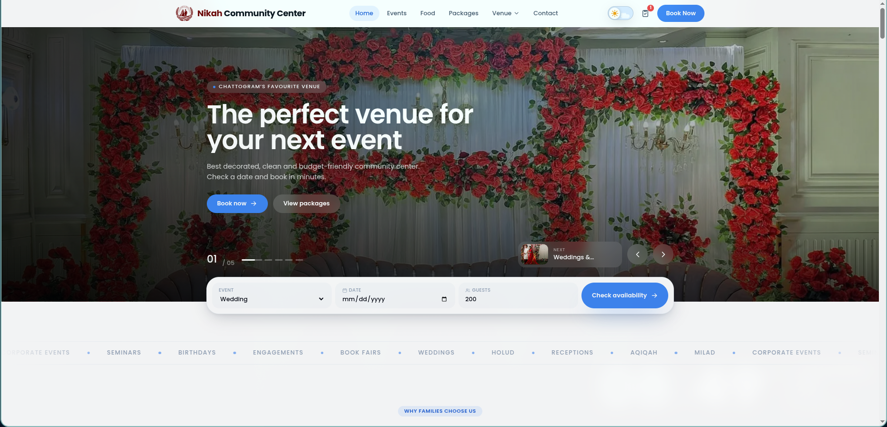
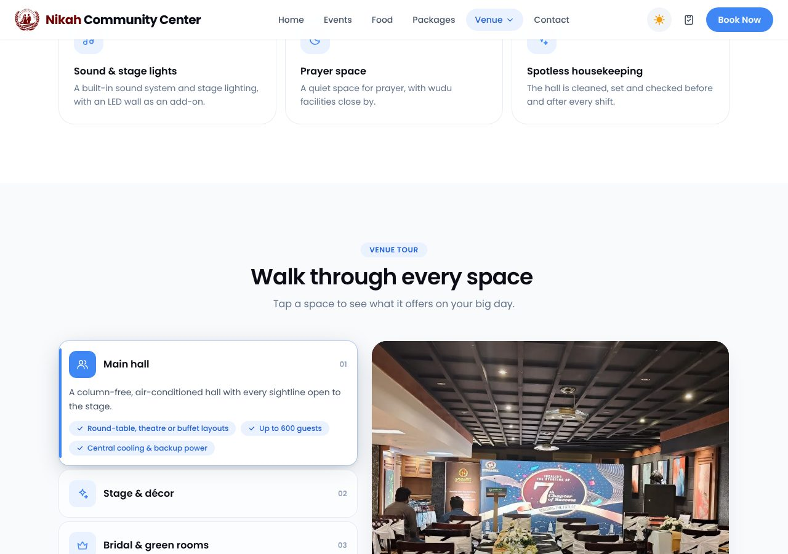
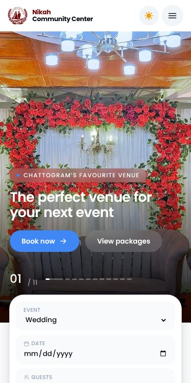

<div align="center">

# Nikah Community Center

**Online booking website for a wedding & events venue in Chattogram, Bangladesh**

[**Live site →**](https://nikah-convention.vercel.app/) · [GitHub repo](https://github.com/Hafiz-Sakib/Nikah-Community-Center)

     



</div>

## Table of contents

- [Overview](#overview)
- [Features](#features)
- [Screenshots](#screenshots)
- [Tech stack](#tech-stack)
- [Project structure](#project-structure)
- [Getting started](#getting-started)
- [Environment variables](#environment-variables)
- [Pages and routes](#pages-and-routes)
- [How booking works](#how-booking-works)
- [Timers: event countdown and payment deadline](#timers-event-countdown-and-payment-deadline)
- [The 404 page](#the-404-page)
- [Theming and animation](#theming-and-animation)
- [Customising](#customising)
- [Deployment](#deployment-vercel)
- [Backend](#backend)
- [License](#license)

## Overview

A complete venue website: guests browse events, packages, food menus and facilities, check live availability, book a date, pay the advance and download an invoice. Staff confirm bookings and verify payments from a dashboard. It works on phones, installs as an app, and has a day / night theme.

- **Live:** https://nikah-convention.vercel.app/
- **Source:** https://github.com/Hafiz-Sakib/Nikah-Community-Center
- **API:** the `Nikah-Community-Center-Backend` project (Express + Supabase), see [Backend](#backend)

## Features

**For guests**

- **Hero carousel** with 11 slides, focus points so faces stay in frame, swipe and keyboard support
- **Booking wizard** (event → date & shift → details → confirm): live availability from the database, no double booking, weekend surcharge, 30% advance, booking ID, `.ics` calendar file, WhatsApp share
- **Accounts:** Google or email + password login (Supabase Auth); name and Google photo in the navbar; "My bookings" only when logged in
- **Payments:** submit bKash / Nagad / bank / card payment records; staff verify them and the booking confirms automatically (the card modal is a demo, no real charge)
- **Event countdown:** a small reverse timer on every active booking shows how long is left until the event
- **3-day payment deadline:** an unpaid booking is cancelled automatically after 3 days, with a clear, escalating warning on screen
- **PDF invoice** with a Code 128 barcode of the booking ID
- **Packages** with animated cards, Shift / Full-day price switch and a compare table
- **Facilities** page: amenity strip, interactive venue tour, included checklist, safety section
- **Food menu** with Bengali wedding dishes and per-package variations
- **Photo gallery** with lightbox (about 100 photos, cached as you browse)
- **Animated 404 page** with fairy lights, draggable rings and a "did you mean" suggestion

**For staff (`/admin`)**

- Stats: total bookings, waiting for action, confirmed revenue, events in the next 30 days
- Search, status filter, date range, pagination, CSV export
- Confirm / cancel / edit any booking, record walk-in bookings and cash payments, verify or reject submitted payments
- Event countdown and "auto-cancel in …" chip on every booking card
- Hold-to-delete button so a booking can never be deleted by a stray click

**General**

- **Day / night mode** with a circle-reveal animation, remembers your choice
- **PWA:** installable, works offline after the first visit; the install icon sits next to the menu on mobile
- **Clean URLs** such as `/events` and `/packages`, plus automatic redirect for old `/#/events` links

## Screenshots

| Packages | Facilities | Mobile |
|---|---|---|
|  |  |  |

## Tech stack

| Area | Tools |
|---|---|
| UI | React 18, Tailwind CSS 3, Poppins (`@fontsource`) |
| Animation | Motion (`motion/react`), CSS keyframes for ambient effects |
| Routing | React Router 7 (`BrowserRouter`) |
| Auth + data | Supabase Auth (browser) and the Express API (bookings, payments, admin) |
| PDF | jsPDF + html2canvas (invoice) |
| Build / PWA | Vite 5, `vite-plugin-pwa` (Workbox) |
| Hosting | Vercel |

## Project structure

```bash
Nikah-Community-Center-Frontend/
├── index.html                     # app shell, meta tags, PWA hooks
├── vite.config.js                 # alias "@" -> src, manual chunks, PWA manifest + Workbox
├── tailwind.config.js             # theme tokens (CSS variables), keyframes, shadows
├── postcss.config.js
├── jsconfig.json                  # "@/..." imports in the editor
├── vercel.json                    # rewrite every path to index.html (clean URLs)
├── .env.example                   # VITE_* variables (copy to .env)
├── IMAGES.md                      # where every photo is used
├── docs/
│   └── screenshots/               # images used in this README
├── public/
│   ├── favicon.*, apple-touch-icon.png, pwa-*.png     # icons
│   └── images/                    # hero, food, event, auth photos (.webp)
│       └── gallery/               # ~100 gallery photos + -t thumbnails
└── src/
    ├── main.jsx                   # entry: Router > Auth > Bookings providers > <App />
    ├── App.jsx                    # navbar, animated routes, footer, toaster, hold reminder
    ├── index.css                  # theme tokens (day / night), base styles, 404 keyframes
    ├── theme.js                   # day / night switch + circle-reveal transition
    ├── data.js                    # CONTENT: contact, packages, add-ons, food, events, FAQs, payment numbers
    ├── galleryPhotos.js           # gallery photo list
    │
    ├── context/
    │   └── AuthContext.jsx        # Supabase session, user, role (user / admin)
    │
    ├── lib/
    │   ├── api.js                 # fetch wrapper: JWT header, 401 refresh, cold-start hint
    │   ├── supabase.js            # Supabase browser client (anon key only)
    │   ├── bookings.js            # BookingsProvider: the user's own bookings, shared state
    │   ├── useAvailability.js     # booked-days map for the calendar
    │   ├── store.js               # toasts, date helpers, shifts, money(), price quote()
    │   ├── countdown.js           # shared 1 s clock, event window, payment-hold maths
    │   ├── invoice.js             # bill rows, WhatsApp text, paid total
    │   ├── gateway.js             # demo card gateway helpers
    │   └── code128.js             # Code 128 barcode encoder
    │
    ├── pages/                     # one file per route
    │   ├── Home.jsx  About.jsx  EventsPage.jsx  FoodPage.jsx  PackagesPage.jsx
    │   ├── FacilitiesPage.jsx  GalleryPage.jsx  ContactPage.jsx  BookingPage.jsx
    │   ├── Login.jsx  Signup.jsx  AuthCallback.jsx  ResetPassword.jsx
    │   └── NotFound.jsx           # animated 404
    │
    └── components/
        ├── Navbar.jsx  Footer.jsx  Logo.jsx  UserMenu.jsx  ThemeToggle.jsx  Install.jsx
        ├── Hero.jsx  PageHero.jsx  SectionHead.jsx  Marquee.jsx  PhotoMarquee.jsx  PhotoStrip.jsx
        ├── Booking.jsx            # booking wizard (4 steps)
        ├── BookingSteps.jsx  Calendar.jsx  AvailabilityBar.jsx  EditBooking.jsx
        ├── MyBookings.jsx         # the user's bookings: timer, warning, pay, edit, cancel
        ├── Billing.jsx            # bill, payment methods, card gateway, payment list
        ├── Admin.jsx              # staff dashboard
        ├── EventTimer.jsx         # reverse timer to the event            (new)
        ├── HoldTimer.jsx          # 3-day payment warning + admin chip     (new)
        ├── HoldReminder.jsx       # floating "payment due" nudge           (new)
        ├── Modal.jsx              # shared dialog: bottom sheet on phones, centred card on desktop
        ├── Invoice.jsx  InvoiceView.jsx  Barcode.jsx  StatusPill.jsx
        ├── Packages.jsx  Facilities.jsx  FacilityExtras.jsx  Food.jsx  Events.jsx
        ├── Gallery.jsx  GalleryAll.jsx  Lightbox.jsx  Moments.jsx  Reviews.jsx
        ├── Faq.jsx  HomeFaq.jsx  ContactInfo.jsx  CtaBand.jsx  Statement.jsx  Ceremony.jsx
        ├── HomeInteractive.jsx  PageSections.jsx
        ├── AuthPage.jsx  AuthShell.jsx  auth-card.jsx  RequireAuth.jsx  Avatar.jsx
        ├── ui.jsx                 # BlurText, FlipWords, Magnetic, Underline
        ├── Odometer.jsx  AnimatedNumber.jsx  Reveal.jsx  Toaster.jsx  Icons.jsx  ics.js
        ├── gateway/               # demo card payment (MetalCard, PaymentGateway, marks)
        └── brew/                  # components adapted from Motion Brew
            ├── Button.jsx  PillTabs.jsx  TiltCard.jsx
            ├── ActionButton.jsx   # animated action pills (hover lift, icon wiggle, light sweep)
            └── AmountSlider.jsx  HoldToConfirm.jsx
```

## Getting started

Requirements: Node.js 20+ and a running copy of the API (see [Backend](#backend)).

```bash
git clone https://github.com/Hafiz-Sakib/Nikah-Community-Center.git
cd Nikah-Community-Center
cp .env.example .env     # then fill the three VITE_* values
npm install
npm run dev              # http://localhost:5173
npm run build            # production build in dist/
npm run preview          # preview the production build
```

## Environment variables

| Variable | Example | Notes |
|---|---|---|
| `VITE_SUPABASE_URL` | `https://xxxx.supabase.co` | Supabase project URL |
| `VITE_SUPABASE_ANON_KEY` | `eyJ…` | **anon / publishable key only**, never the `service_role` key |
| `VITE_SITE_URL` | _(empty)_ | Optional. Public site URL used as the OAuth/email redirect; defaults to the current origin |
| `VITE_API_URL` | `http://localhost:4000` | In production: your Render URL |

Add the same three variables in Vercel → Project → Settings → Environment Variables.

## Pages and routes

| Route | Page | Access |
|---|---|---|
| `/` | Home | public |
| `/events` | Events | public |
| `/food` | Food menus | public |
| `/packages` | Packages & pricing | public |
| `/facilities` | Facilities | public |
| `/gallery` | Photo gallery | public |
| `/about` | About us | public |
| `/contact` | Contact | public |
| `/booking` | Booking wizard (`?event=Wedding&package=wedding-plus&date=2026-12-05&guests=200`) | public to browse, login to confirm |
| `/my-bookings` | Your bookings: timers, pay, edit, cancel, invoice | logged in |
| `/admin` | Staff dashboard | admin role |
| `/login`, `/signup`, `/auth/callback`, `/reset-password` | Authentication | public |
| `*` | Animated 404 | public |

## How booking works

```text
 Guest                     Frontend                         API + Supabase
 ─────                     ────────                         ──────────────
 pick date & shift  ───►   live availability  ───────────►  GET /availability
 confirm booking    ───►   POST /bookings     ───────────►  price computed on the server,
                                                            status = pending, 3-day hold starts
 pay advance (30%)  ───►   POST /bookings/:id/payments ──►  payment = pending
 staff verify       ───►   PATCH /admin/payments/:id  ────►  verified ≥ advance → confirmed
 no payment in 3 days ───► (timer reaches 0)  ───────────►  booking auto-cancelled (expired)
```

Booking statuses: `pending` → `confirmed` → `completed`, or `cancelled` / `expired`. The server is the source of truth for prices and rules; the frontend only displays them.

## Timers: event countdown and payment deadline

**Event countdown** (`EventTimer.jsx`)
A small pill on every pending or confirmed booking, in both **My bookings** and the **Admin** dashboard. It counts down to the start of the booked shift and ticks every second: `Event in 12d 04h 22m 10s`.

- The start time is calculated in Bangladesh time (UTC+6), so it is right on any device
- Colour changes as the event gets closer (more than 7 days, under 7 days, under 24 hours)
- Shows `Happening now` during the shift and `Event ended` afterwards

**Payment deadline** (`HoldTimer.jsx`, `HoldReminder.jsx`)
A new unpaid booking holds its date for **3 days**. If nothing is paid by then, the server cancels it automatically (status `expired`) and the date goes back on sale.

| Where | What the guest sees |
|---|---|
| Booking confirmation step | "Pay within 3 days" notice with the advance amount |
| Billing screen after booking | Warning banner with a live countdown and progress bar |
| My bookings | Warning on each unpaid booking, with a **Pay now** button |
| Any page | Floating reminder when less than 24 hours are left (dismissible) |
| After the deadline | Card flips to "cancelled automatically" without reloading the page |

The warning escalates: amber (more than 24 h), orange (under 24 h), red and pulsing (under 6 h). If the guest has already submitted a payment that staff have not verified yet, the timer pauses and the card says so, exactly like the server rule. Staff see an `Auto-cancel in 2d 4h` chip on each unpaid booking.

All timers share a single 1-second clock (`lib/countdown.js`), so a page with many cards still runs one interval.

## The 404 page

`src/pages/NotFound.jsx` is a small piece of venue atmosphere rather than a dead end:

- Strings of fairy lights sway and twinkle across the top, and gold dust drifts upwards
- The two `4`s scramble like a decoder and settle (click one to replay)
- The zero is a pair of wedding rings that draw themselves in, lean away from the cursor and can be dragged; they spring back
- The mistyped link is typed out like a terminal, and a **"Did you mean …?"** chip suggests the closest real page
- Quick links drop in like little tags and wobble into place
- Everything respects `prefers-reduced-motion`

## Theming and animation

- All colours are CSS variables in `src/index.css` (`:root` for day, `:root.dark` for night); Tailwind reads them in `tailwind.config.js`, so one class works in both themes
- Interactive components in `src/components/brew/` are adapted from [Motion Brew](https://motion-brew.com/) and themed with the site's tokens
- Page transitions live in `App.jsx`; ambient effects (marquee, fairy lights) are CSS keyframes in `index.css`

## Customising

- Contact details, packages, prices, facilities, events, FAQs: `src/data.js`
- Payment numbers: `PAYMENT` in `src/data.js`
- Hero slides and their focus points: `slides` in `src/data.js` (`pos` = `object-position`, `side: 'right'` moves text right)
- Photos: `public/images` (see `IMAGES.md`)
- Payment deadline length: set `HOLD_HOURS` on the **server** (default 72). The frontend reads the value the API sends with each booking, so nothing changes here
- **If you change a price, change it in the server `src/config/pricing.js` too.** The server decides what a booking costs; old invoices keep their saved price

## Deployment (Vercel)

`vercel.json` rewrites every path to `index.html`, so direct links such as `/events` work after a refresh. Import the repo in Vercel (framework: Vite, build `npm run build`, output `dist`) and add the three `VITE_*` variables.

## Backend

Bookings, payments and users live in Supabase behind the Express API in the **Nikah-Community-Center-Backend** project (see its README and `supabase/schema.sql`).

1. Set up the backend first and note its URL (`http://localhost:4000` locally)
2. Copy `.env.example` to `.env` and fill the three `VITE_*` variables
3. `npm install && npm run dev` (frontend on :5173, API on :4000)

Packages, add-ons, food and images stay in `src/data.js`.

## License

Personal / portfolio project by [Hafiz Sakib](https://github.com/Hafiz-Sakib).
