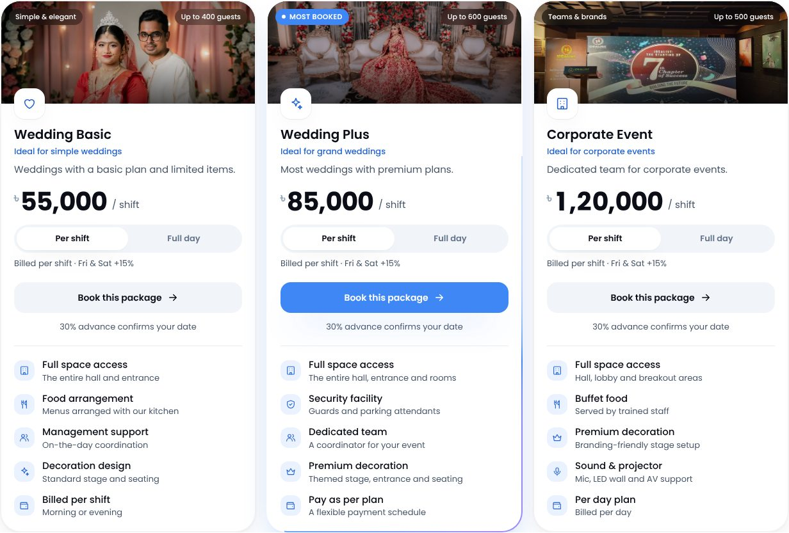

<div align="center">

# Nikah Community Center

**Online booking website for a wedding & events venue in Chattogram, Bangladesh**

[**Live site →**](https://nikah-convention.vercel.app/) · [GitHub repo](https://github.com/Hafiz-Sakib/Nikah-Community-Center)

   


</div>

## Overview

A complete venue website: guests browse events, packages, food menus and facilities, check live availability, book a date, pay the advance and download an invoice. Works on phones, installs as an app, and has a day / night theme.

- **Live:** https://nikah-convention.vercel.app/
- **Source:** https://github.com/Hafiz-Sakib/Nikah-Community-Center

## Features

- **Hero carousel** with 11 slides, focus points so faces stay in frame, swipe and keyboard support
- **Booking system** (Supabase + Express API): login required to book, live availability from the database, no double booking, weekend surcharge, 30% advance, booking ID, `.ics` calendar file, WhatsApp share
- **Accounts**: Google or email + password login (Supabase Auth); name + Google photo in the navbar; "My bookings" only when logged in; admin role from the database
- **Payments**: users submit bKash/Nagad/bank/card payment records, admin verifies, booking auto-confirms (card modal is a demo, no real charge)
- **PDF invoice** with a Code 128 barcode of the booking ID
- **Packages** with animated cards, Shift / Full-day price switch and a compare table
- **Facilities** page: amenity strip, interactive venue tour, included checklist, safety section
- **Food menu** with Bengali wedding dishes and per-package variations
- **My bookings** page and a staff dashboard (`/admin`)
- **Day / night mode** with a circle-reveal animation, remembers your choice
- **PWA**: installable, works offline after the first visit; install icon sits next to the menu on mobile
- **Clean URLs** such as `/events` and `/packages`

## Screenshots

| Packages | Facilities | Mobile |
|---|---|---|
|  |  |  |

## Tech stack

React 18 · Vite 5 · Tailwind CSS 3 · Motion (`motion/react`) · React Router 7 (BrowserRouter) · vite-plugin-pwa · jsPDF + html2canvas

## Getting started

```bash
git clone https://github.com/Hafiz-Sakib/Nikah-Community-Center.git
cd Nikah-Community-Center
npm install
npm run dev       # http://localhost:5173
npm run build     # production build in dist/
npm run preview   # preview the build
```

## Pages

| Route | Page |
|---|---|
| `/` | Home |
| `/events` | Events |
| `/food` | Food menus |
| `/packages` | Packages & pricing |
| `/facilities` | Facilities |
| `/gallery` | Photo gallery |
| `/about` | About us |
| `/contact` | Contact |
| `/booking` | Booking wizard (`?event=Wedding&package=wedding-plus&date=2026-12-05&guests=200`) |
| `/my-bookings` | Look up or cancel a booking |
| `/admin` | Staff dashboard (passcode in `src/data.js`) |

Old links like `/#/events` redirect to `/events` automatically.

## Deployment (Vercel)

`vercel.json` rewrites every path to `index.html`, so direct links such as `/events` work after a refresh. Import the repo in Vercel (framework: Vite, build `npm run build`, output `dist`).

## Customising

- Contact details, packages, prices, facilities, events, FAQs: `src/data.js`
- Payment numbers: `PAYMENT` in `src/data.js`
- Hero slides and their focus points: `slides` in `src/data.js` (`pos` = `object-position`, `side: 'right'` moves text right)
- Photos: `public/images` (see `IMAGES.md`)
- Booking logic is a localStorage demo in `src/lib/store.js`; replace it with real API calls for production

## License

Personal / portfolio project by [Hafiz Sakib](https://github.com/Hafiz-Sakib).


## Backend setup (new)

Bookings, payments and users now live in Supabase behind the Express API in the `ncc-server` project (see its README and `supabase/schema.sql`).

1. Copy `.env.example` to `.env` and fill:
   - `VITE_SUPABASE_URL`, `VITE_SUPABASE_ANON_KEY` (anon/publishable key only — never the service_role key)
   - `VITE_API_URL` (`http://localhost:4000` locally, your Render URL in production)
2. `npm install && npm run dev` (frontend on :5173, API on :4000).
3. Add the same three `VITE_*` variables in Vercel.
4. Packages, add-ons, food, images stay in `src/data.js`. **If you change a price, change it in the server `src/config/pricing.js` too** — the server is the source of truth for what a booking costs, and old invoices keep their saved price.
